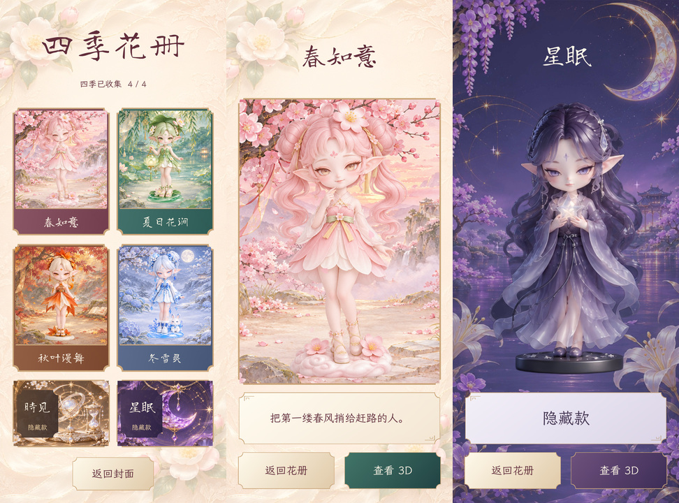

# 四时花旅 · Four Seasons AR

四季角色卡与 Android AR 花册。当前稳定版 **1.11** 支持扫描四张卡、点亮花册、查看六款人物的 2D 原画与 3D 模型。2.0 候选版加入六位可动花灵、点击收录、现实放置和原地轮换。



## 安装与体验

[下载 1.11](https://github.com/Fairy-fly/FourSeasonsAR/releases/tag/v1.11)。在支持 ARCore 的 Android 手机上安装 APK，允许相机权限。体验 ZIP 包含卡片、打印网页与操作说明。按实际尺寸打印，方形识别图外缘宽 80 mm。1.11 的扫码人物采用 2.5D，花册内可切换到可旋转的三维模型。

[下载 2.0 候选版](https://github.com/Fairy-fly/FourSeasonsAR/releases)。体验包包含 ARM64 APK、四张识别图和同版体验与验收说明。六位可编辑的可动 Blender 模型随 2.0.0-rc.1 发布。实际测试状态见 [Android 真机验收](docs/Android真机验收.md) 和 [GitHub 进度](https://github.com/Fairy-fly/FourSeasonsAR/issues/4)。

## 从源码构建

使用 Unity 6000.3.29f1，安装 Android Build Support、配套 SDK、NDK 和 OpenJDK。通过 Hub 打开 UnityProject。AR Foundation 与 ARCore XR Plugin 在 Packages 中锁定为 6.3.5。在 Windows PowerShell 中运行以下命令，按本机安装位置调整参数。

```powershell
.\tools\build-android.ps1 -Editor 'D:\Unity\6000.3.29f1\Editor\Unity.exe' -CacheRoot 'D:\Unity' -Method SpringSample.ReviewAndBuildApk -WithGraphics
```

APK 在 builds 下，编辑器验证日志与截图在 reports 下。已导入的移动端模型随工程提供。要编辑高模或重新处理 Blender 素材，请从同版 Release 下载 FourSeasonsAR-1.11-ModelSources.zip 并解压到仓库根目录。用 SHA256SUMS.txt 核对下载。操作细节见 [体验说明](docs/四季体验说明.md) 和 [1.11 验证记录](reports/FOUR_SEASONS_1.11.md)。

## 授权

自有代码使用 [MIT](LICENSE)。项目有权授权的原创角色原画、识别卡、美术与角色模型采用 [CC BY 4.0](LICENSE-Art.txt)，允许署名后改编与商用。署名可写作「《四时花旅》」，附仓库和许可证链接，并注明改动。第三方字体按 [各自的许可证](UnityProject/Assets/StreamingAssets/FontLicenses) 使用。Unity、AR Foundation、ARCore 和其他第三方组件遵循各自条款。
